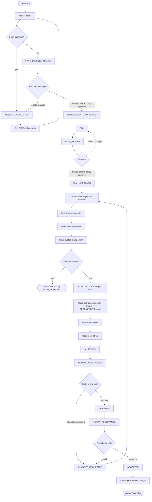
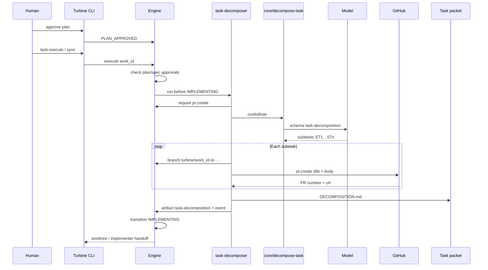
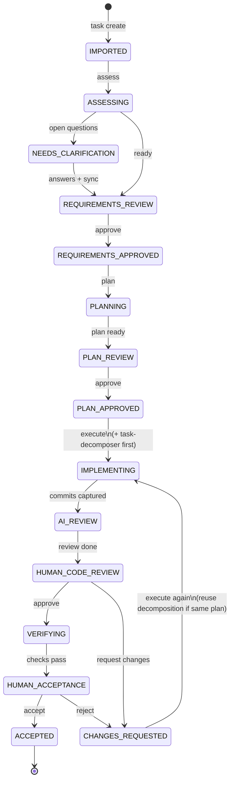
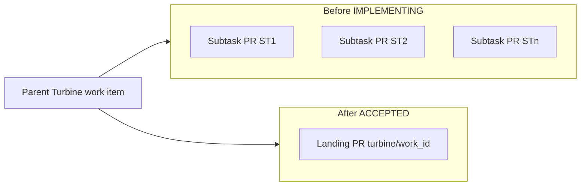

# Task workflow (with `task-decomposer`)

Full Turbine Hall task lifecycle, including the **task-decomposer** step that runs automatically before execution and opens one small PR per subtask.

## End-to-end flowchart



## Sequence: pre-execute decomposition



## State machine (work item)



## What `task-decomposer` produces

| Output | Where |
|---|---|
| Subtask list (id, title, description, requirementIds, files) | Model → `task-decomposition` artifact |
| **Subtask count** (visible) | `DECOMPOSITION.md` header (`**Subtasks: N**`) + `task.decomposition-ready` event + `turbine task next` |
| One branch per subtask | `turbine/<workId>-st-…` at **`git.defaultBaseBranch` tip** (not the current checkout) |
| One PR per subtask | GitHub via `pr.create` against `git.defaultBaseBranch`; refuses mega-diffs over `git.maxSubtaskPrChangedLines` |
| Human-readable table | `.turbine/tasks/<workId>/DECOMPOSITION.md` |
| Audit events | `task.decomposition-ready`, then `task.decomposed` |

Configure in `.turbine/project.yaml`:

```yaml
git:
  defaultBaseBranch: main
  maxSubtaskPrChangedLines: 400
```

Same plan hash on a later execute → **reuse** recorded PRs (no duplicates).

Local human gates (requirements/plan/code review/acceptance) stay on by default; relax them only with an approved lane policy (`turbine policy approve …`) so humans review GitHub PRs instead.

## Parent vs landing PR



- **Subtask PRs** — opened by `task-decomposer` so each slice is reviewable early.
- **Landing PR** — still the accepted head for the parent task (`turbine/<workId>`), unchanged by decomposition.
